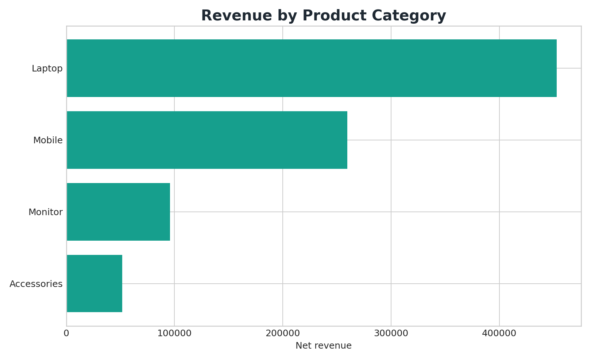
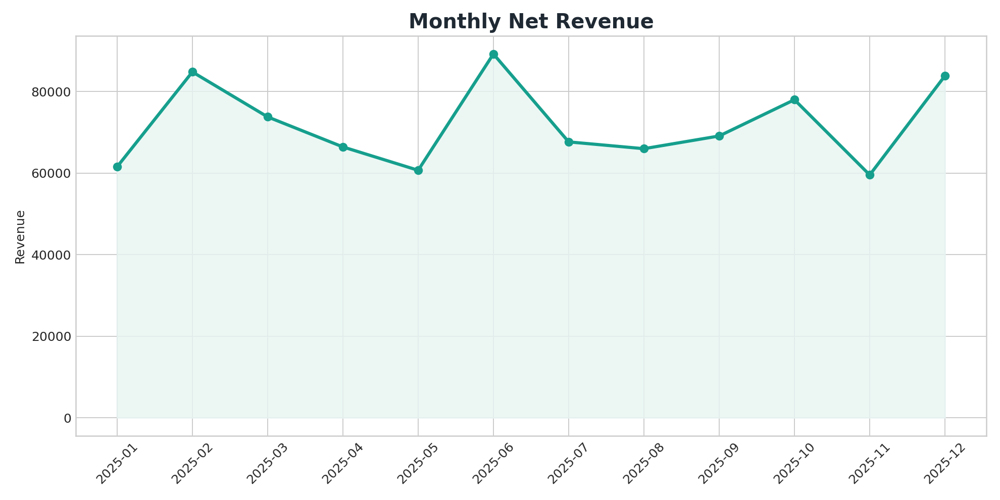
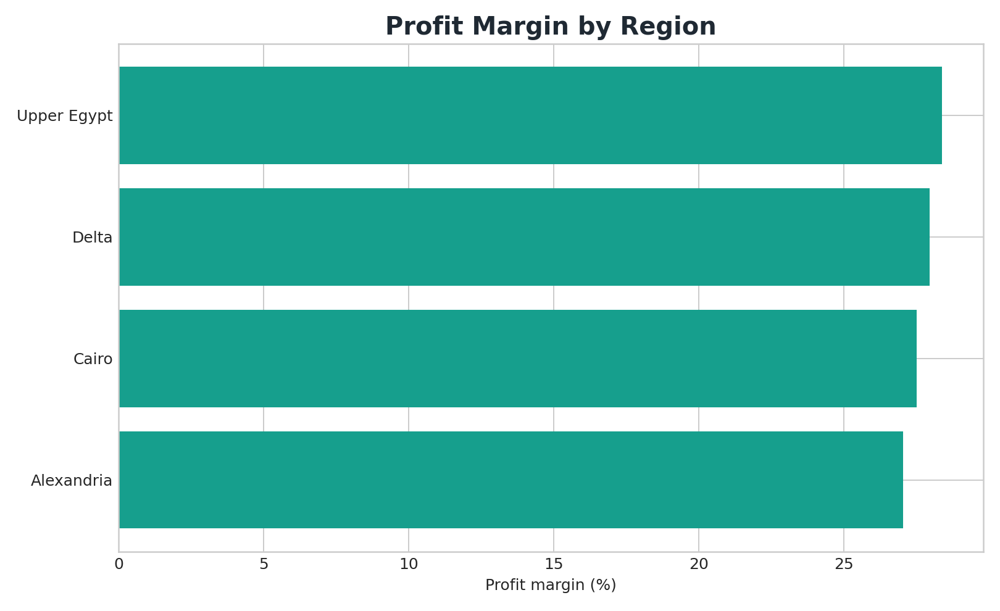
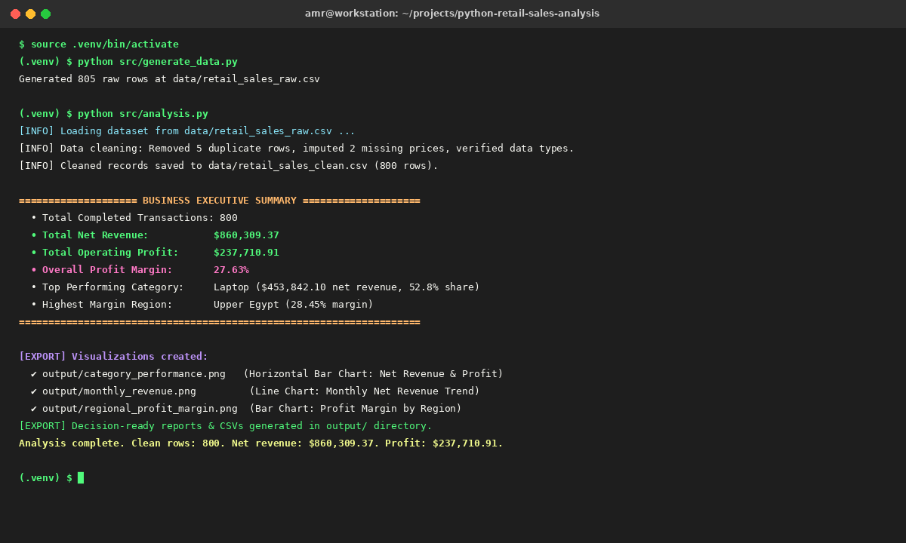

# Python Retail Sales Analysis

A reproducible Python data-analysis project that cleans retail transaction data, engineers business metrics, analyzes performance, and exports decision-ready tables and charts.

The project was developed from Python, NumPy, Pandas, file-handling, and data-cleaning coursework and expanded into a complete portfolio project.

## Project Screenshots









## Business problem

A multi-region technology retailer needs to understand revenue, profit, category performance, regional performance, customer segments, and monthly trends. The raw file also contains realistic data-quality issues such as missing values and duplicate rows.

## Skills demonstrated

- Python project structure and file handling
- NumPy and Pandas
- Data cleaning and validation
- Feature engineering
- Grouping, aggregation, ranking, and time-series analysis
- KPI calculation
- Matplotlib data visualization
- Reproducible CSV and Markdown outputs

## Repository structure

```text
data/
    retail_sales_raw.csv
    retail_sales_clean.csv
output/
    analysis_report.md
    category_performance.png
    monthly_revenue.png
    regional_profit_margin.png
    category_summary.csv
    monthly_summary.csv
    top_products.csv
src/
    generate_data.py
    analysis.py
requirements.txt
```

## How to run

```bash
python -m venv .venv

# Windows
.venv\Scripts\activate

# macOS/Linux
source .venv/bin/activate

pip install -r requirements.txt
python src/generate_data.py
python src/analysis.py
```

## Analysis workflow

1. Generate a deterministic raw retail dataset.
2. Inspect data types, missing values, duplicates, and invalid values.
3. Clean and standardize the data.
4. Engineer revenue, cost, profit, profit margin, month, and quarter fields.
5. Analyze category, product, region, channel, customer segment, and monthly performance.
6. Export cleaned data, summary tables, charts, and a written report.

## Author

Amr Nader Wahba - Junior Data Analyst  
GitHub: [amr-n-wahba](https://github.com/amr-n-wahba)
